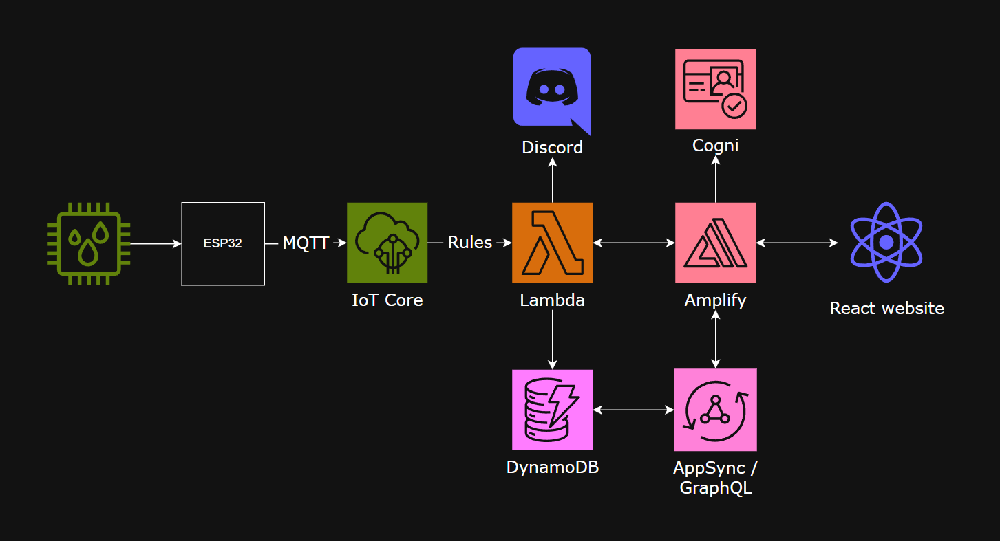
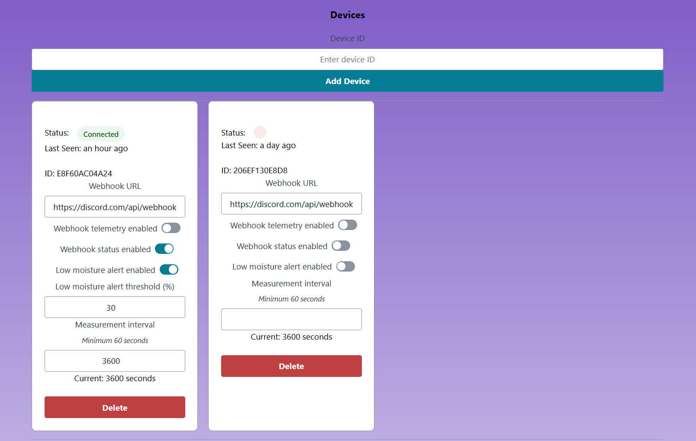
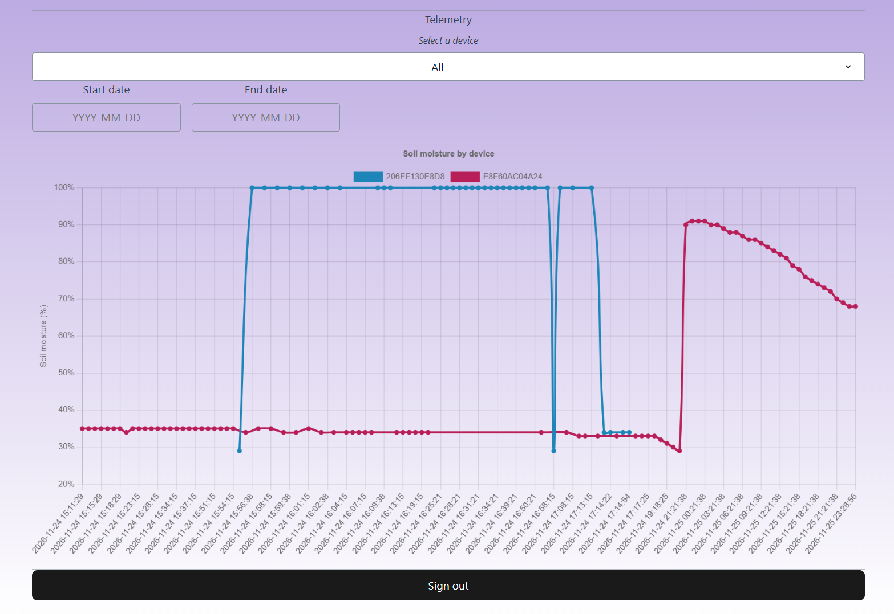
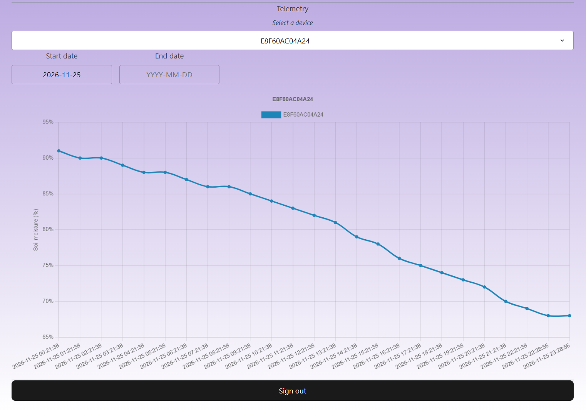
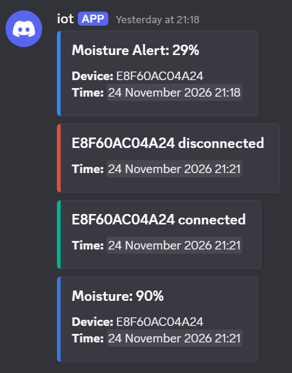

# SoilSync Dashboard

Web dashboard for the [SoilSync soil-moisture sensor](https://github.com/JesperTennevik/SoilSync). It displays device status and moisture history, lets you configure the sensor measurement interval, and can send webhook notifications.

# Features

- Sign in with Amazon Cognito.
- Register and manage devices.
- View device connection status and its latest measurement time.
- Plots telemetry readings per device and optional start/end date filters.
- Update a device's measurement interval through its AWS IoT Device Shadow.
- Telemetry, connection-status and low-moisture alert notifications using a Discord webhook.

# Architecture overveiw




# AWS IoT Core setup

## Things
Refer to the [SoilSync repository](https://github.com/JesperTennevik/SoilSync) for instrutions on how to set up `things` in IoT Core. 

## Policies
### MQTT
To allow devices to connect to IoT Core but also limit the access they have in order to prevent malicious activities you can use this policy.
``` JSON
{
  "Version": "2012-10-17",
  "Statement": [
    {
      "Effect": "Allow",
      "Action": "iot:Connect",
      "Resource": "arn:aws:iot:eu-north-1:721274598729:client/${iot:Connection.Thing.ThingName}"
    },
    {
      "Effect": "Allow",
      "Action": "iot:Publish",
      "Resource": [
        "arn:aws:iot:eu-north-1:721274598729:topic/${iot:Connection.Thing.ThingName}*",
        "arn:aws:iot:eu-north-1:721274598729:topic/$aws/things/${iot:Connection.Thing.ThingName}/shadow/*"
      ]
    },
    {
      "Effect": "Allow",
      "Action": "iot:Subscribe",
      "Resource": [
        "arn:aws:iot:eu-north-1:721274598729:topicfilter/${iot:Connection.Thing.ThingName}*",
        "arn:aws:iot:eu-north-1:721274598729:topicfilter/$aws/things/${iot:Connection.Thing.ThingName}/shadow/*"
      ]
    },
    {
      "Effect": "Allow",
      "Action": "iot:Receive",
      "Resource": [
        "arn:aws:iot:eu-north-1:721274598729:topic/${iot:Connection.Thing.ThingName}*",
        "arn:aws:iot:eu-north-1:721274598729:topic/$aws/things/${iot:Connection.Thing.ThingName}/shadow/*"
      ]
    }
  ]
}
```

## Rules

For the backend to be able to connect to IoT Core correctly theese rules must be created manually.
- Go to: `Message routing -> Rules`
### Telemetry
Set the action to the Lambda containing: `graphqlIoTCoreTelemetry`. 
```sql
SELECT
  *,
  topic(1) AS device_id,
  topic(1) AS deviceName,
  parse_time("yyyy-MM-dd'T'HH:mm:ss.SSS'Z'", timestamp(), "UTC") AS timestamp
FROM '+/telemetry'
```

### Connection status
Set the action to the Lambda containing: `graphqlIoTCoreStatus`.
```sql
SELECT clientId, eventType, timestamp
FROM '$aws/events/presence/+/+'
```

### Device Shadow synchronization
Set the action to the Lambda containing: `storeDeviceShadow`.
```sql
SELECT
  topic(3) AS device_id,
  current.state.desired AS shadow_desired,
  current.state.reported AS shadow_reported
FROM '$aws/things/+/shadow/update/documents'
```
# Scalability
The project is using a pay-as-you-go model and AWS services that are scalable by nature.
The limiting factor will be amout of devices that you own.

- **IoT Core** can provision and manage all of your devices and their communication to the cloud platform with no limit. 
- **Lambda.**
Serverless function where you pay-per-invocation. They run on events and scales automatically.
- **Cognito** manges the websites sign in and user pools. There is no limit to the amout of users that can be created.
- **DynamoDB** is an incredibly fast and automatically scaling NoSQL database making it ideal for large volumes of real-time data.


# Security
- All communication within the project use encrypted protocols notably: MQTTS and HTTPS.
- mTLS is required for Devices to communicate with IoT Core. 
- Security policies and IAM Roles ensures devices and Users have restricted access.
- User accounts for the website is managed by AWS Cognito.

# S3 Storage
S3 storage can be used in addition to the DynamoDB for cheap long term storage. This can easily be achived by periodically batch-exporting the DynamoDB tables either manually or via a scheduled lambda.

# Images




